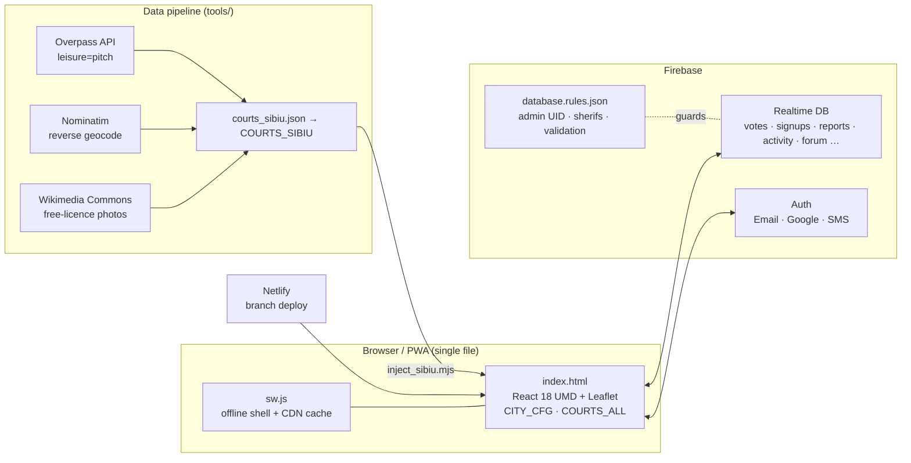

# From Grey to Play

Civic PWA that documents the gap between central and peripheral public sports courts —
live for **Târgu Mureș** (field-verified) and **Sibiu** (OpenStreetMap, pending field checks).

**Live:** https://fromgreytoplay.netlify.app · Sibiu: https://fromgreytoplay.netlify.app/?c=sibiu

Built by Cîmpan Teodor for Astra Hack (Sibiu, 6–7 Nov 2026).

## What it does

- **Map of every public court** with status, condition, health score, satellite time-machine, QR poster.
- **Citizen reports** with photos and GPS, tracked from *received* to *resolved*.
- **Petition + letter generator** that addresses the right City Hall and produces a PDF.
- **Community layer:** forum, events, teams, pixel mural, pledges, live activity ticker.
- **City Pulse:** a time-lapse of every civic action, with shareable stats.
- **Admin + sherifs:** supreme admin (fixed UID) and moderators; destructive actions are admin-only and enforced by database rules.
- **Open data:** JSON/CSV export (CC BY 4.0), personal data stripped.

## Architecture



- **No build step.** Everything ships as `index.html` + `manifest.json` + `sw.js` + `icons/`.
- **Multi-city:** `?c=tgm|sibiu` → `localStorage g2p_city` → `tgm`. `COURTS` is `COURTS_ALL` filtered by city; texts, letters and City Hall contacts follow `CITY_HALL` / `cityName()`.
- **Security:** see [SECURITY.md](SECURITY.md). Rules: public writes are create-only and validated; votes are increment-only; `signups`, `users`, `partnerRequests` are private.

## Run locally

Any static server works, for example:

```bash
npx serve .            # or: python -m http.server
```

Google sign-in needs the deployed domain (Firebase authorized domains).

## Tests

```bash
node --test tests/app.test.mjs
```

Tests load functions and data straight from `index.html` (no duplication): weather/health-score logic,
timestamp sorting, data invariants for both cities, translation completeness, no hardcoded secrets.
CI runs them on every push (`.github/workflows/test.yml`).

## Refresh Sibiu data

```bash
node tools/fetch_osm_sibiu.mjs     # Overpass → tools/data/osm_sibiu.json
node tools/enrich_sibiu.mjs        # Nominatim + Commons → courts_sibiu.json + tools/REPORT.md
node tools/inject_sibiu.mjs        # writes COURTS_SIBIU into index.html
```

## Data & licences

- Sibiu courts and map tiles: © OpenStreetMap contributors, [ODbL](https://www.openstreetmap.org/copyright).
- Târgu Mureș courts: field research by the author.
- Exported open data: CC BY 4.0.
